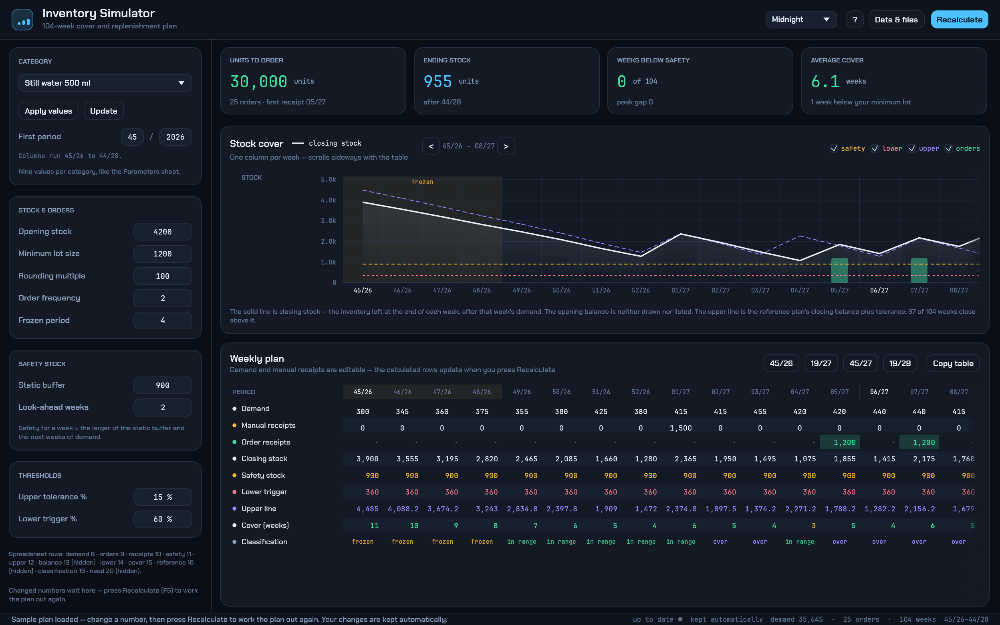

# Inventory Simulator

A desktop planning tool for 104 weeks of demand. Type in a demand curve, and it
works out the safety stock, the lower and upper stock thresholds, the order
receipts on your order rhythm, and the weeks of cover — with a live chart and an
editable weekly table.

It is a standalone rebuild of an Excel workbook that did the same job with VBA
macros on a `Sheet1` + `Parameters` pair of sheets. The calculation order and the
rules are the same, so the numbers match the spreadsheet routine: safety stock =
the larger of a static buffer and the next *N* weeks of demand; receipts placed
after a frozen period, raised to a minimum lot size, rounded up to a packing
multiple, then consolidated onto the order frequency; thresholds and cover weeks
on top of that.



## What it does

* **Categories.** Nine values per category — opening stock, minimum lot size,
  rounding multiple, order frequency, frozen period, static safety buffer,
  look-ahead weeks, upper tolerance and lower trigger — loaded from a dropdown.
  Categories are editable and are saved with the plan.
* **Recalculate, like the workbook.** Nothing recomputes behind your back: a
  changed number waits for the **Recalculate** button (or <kbd>F5</kbd>), and the
  screen says what changed and what the rebuild did in plain words.
* **Weekly plan table.** Demand and manual receipts are editable; order
  receipts, closing stock, safety stock, both thresholds, cover weeks and a
  week-by-week classification (frozen, in range, over, below trigger, …) are
  worked out. The workbook's reference receipts and week-by-week requirement are
  still calculated behind the scenes but are not listed, and the start-of-week
  balance is not listed either (cover weeks are worked out from it). Rows scroll
  sideways in blocks of weeks, and <kbd>Tab</kbd> (<kbd>Shift</kbd>+<kbd>Tab</kbd>)
  steps from one week's box to the next — the columns shift by one when the
  cursor reaches the last week in view, so the box being typed in stays on
  screen.
* **Stock cover chart.** Closing stock, safety stock, lower and upper thresholds
  and the order quantities, with the frozen period shaded.
* **Data window.** Paste or type a whole demand or manual-receipt row, generate
  a seasonal demand curve, and import/export CSV.
* **Your figures stay yours.** Opening the plan never rewrites a number you
  typed, and switching category keeps the figures from the one you were on.
  Anything that replaces the numbers on screen can be undone from the status
  bar, and earlier versions of the whole plan are kept and listed under
  **Data & files → Earlier versions**, each one a press away.
* **Autosave.** The plan is kept between runs; "Save a copy" and "Start fresh"
  are there for named copies and resets.
* **Four themes**, keyboard shortcuts, and every figure explained in the help
  window.

## Download

Grab the latest build from the [Releases](../../releases) page:

| System | File | Notes |
| --- | --- | --- |
| Linux x86-64 | `inventory-simulator-*-linux-x86_64.tar.gz` | Needs X11 or Wayland and OpenGL; the tarball holds the binary, this README and the licence. |
| Windows x86-64 | `inventory-simulator-*-windows-x86_64.zip` | Unzip anywhere and run `inventory-simulator.exe`; no installer, no extra runtime. |

On Linux, after unpacking:

```sh
chmod +x inventory-simulator
./inventory-simulator
```

It needs a desktop with OpenGL and the xkbcommon X11 library; most desktops
already have these, and on Ubuntu/Debian they are `sudo apt install
libxkbcommon-x11-0 libgl1`. If either is missing the window will not open.

On Windows, double-click `inventory-simulator.exe`. The first launch may show a
SmartScreen prompt because the file is not code-signed; "More info → Run anyway"
continues. Your plan is stored in `%APPDATA%\inventory-simulator\plan.json`
(`~/.config/inventory-simulator/plan.json` on Linux).

## Build from source

Requires a stable Rust toolchain (2021 edition).

```sh
cargo build --release
./target/release/inventory-simulator
```

On Debian/Ubuntu the build needs the usual windowing headers:

```sh
sudo apt-get install pkg-config libxkbcommon-dev libwayland-dev libgl1-mesa-dev
```

On Windows, install the Rust MSVC toolchain (Visual Studio Build Tools with the
C++ workload) and run `cargo build --release`.

Command line options:

```text
--screenshot <file.png>   draw the window, save a picture, exit (used by checks)
--selftest                print the calculation results as JSON
--pending-demo            draw the "changes waiting" state
--files-demo              open the Data & files window on the Files tab
```

## How the numbers are made

For each of the 104 periods, in this order:

1. **Safety stock** — `max(static buffer, demand of the next N weeks)`.
2. **Lower threshold** — safety stock scaled by `(100 − lower trigger %) / 100`.
3. **Receipts** — after the frozen period, whenever the projected end balance
   falls below safety stock, order the shortfall (at least the minimum lot,
   rounded up to the packing multiple); then consolidate those weekly
   requirements onto the order frequency, placing each order in the first week of
   its window that actually needs stock.
4. **Upper threshold** — built from a reference plan that ignores manual receipts
   and the frozen period, with the tolerance applied to its closing balance.
5. **Cover weeks** — how many weeks the stock balance lasts, counting a partial
   week, rounded half-to-even like the spreadsheet's `Round`.

Manual receipts are respected: a week with a manual receipt never gets a planned
order.

## Licence

The code is MIT licensed — see [LICENSE](LICENSE). The bundled fonts are under
the SIL Open Font License 1.1: [Chakra Petch](https://github.com/cadsonpereira/chakrapetch)
and [JetBrains Mono](https://github.com/JetBrains/JetBrainsMono).
